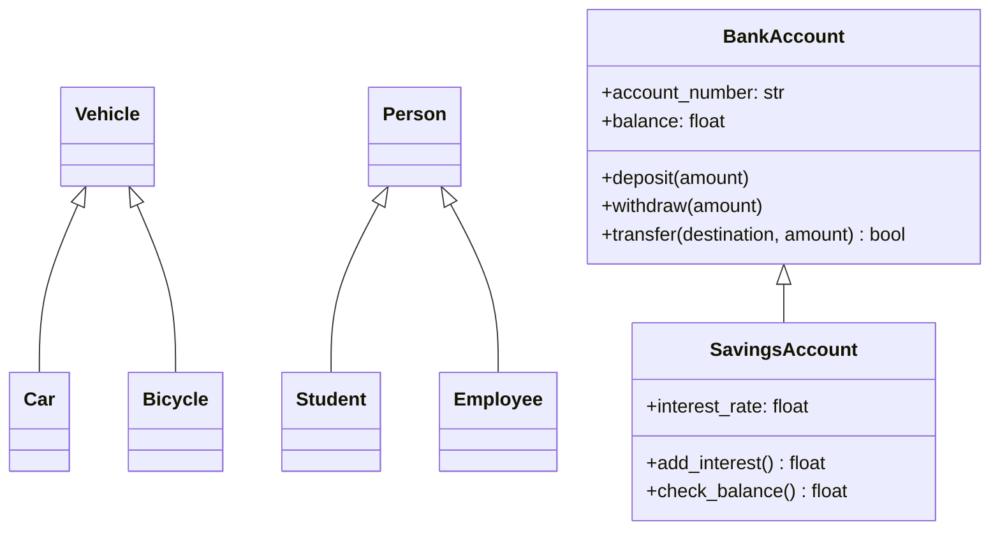

# Exercise 3 (slide 67): OOP problems

**Statement:** [gist: oop_mni_practice.md](https://gist.github.com/bdallard/b2f2c910e3a9b564a30c86991c97b4fc)

Every file runs on its own (`python3 operator_overloading/matrix.py`), and **28 tests** check them all:

```bash
cd 03-oop-problems
pip install pytest
pytest
```

## Operator overloading

Writing a special ("dunder") method makes Python syntax work on our own classes: `a + b` calls `a.__add__(b)`, `a > b` calls `a.__gt__(b)`.

| Problem | File | Operators | Dunders |
| --- | --- | --- | --- |
| 1 | [`complex_number.py`](operator_overloading/complex_number.py) | `+`, `-` on complex numbers | `__add__`, `__sub__` (+ `__str__` to print `2 - 2i`) |
| 2 | [`person.py`](operator_overloading/person.py) | `p1 > p2` compares ages | `__gt__` |
| 4 | [`vector.py`](operator_overloading/vector.py) | `v1 * v2` = dot product | `__mul__` |
| 5 | [`circle.py`](operator_overloading/circle.py) | the 6 comparisons, by radius | `__lt__` `__le__` `__gt__` `__ge__` `__eq__` `__ne__` |
| 6 | [`point.py`](operator_overloading/point.py) | the 6 comparisons, by distance √(x² + y²) | same six |
| 7 | [`matrix.py`](operator_overloading/matrix.py) | `A * B` = matrix product | `__mul__` |

(The statement has no Problem 3.)

**What to remember**
- `self` is the left operand, `other` the right one.
- Arithmetic dunders **return a new object** (`Complex`, `Matrix`). Comparison dunders **return `True` / `False`**.
- The operator is just a method, so we choose what it returns: `Vector * Vector` returns a **number**, `Matrix * Matrix` returns a **Matrix**.
- `sorted()` works on `Circle` objects because it uses `__lt__`.
- Without `__eq__`, `==` checks whether two variables are the *same object in memory*, not whether they hold the same values.

## Inheritance

| Problem | File | Idea |
| --- | --- | --- |
| 1 | [`vehicle.py`](inheritance/vehicle.py) | `Car` and `Bicycle` **override** `drive()`: polymorphism |
| 2 | [`person_student_employee.py`](inheritance/person_student_employee.py) | `Student` and `Employee` call `super().__init__()` and extend `introduce()` |
| 3 | [`bank_account.py`](inheritance/bank_account.py) | `SavingsAccount` adds `interest_rate`, `add_interest()`, `check_balance()`; `transfer()` is inherited |



**What to remember**
- `class Car(Vehicle)` means "a Car **is a** Vehicle".
- `super().__init__(...)` runs the parent's constructor, so its code isn't copied.
- `super().introduce()` reuses the parent's method and adds to it.
- `transfer()` reuses `withdraw()` and `deposit()` instead of changing `balance` directly.
