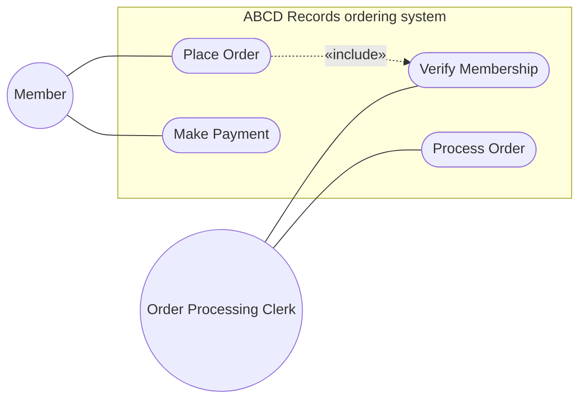
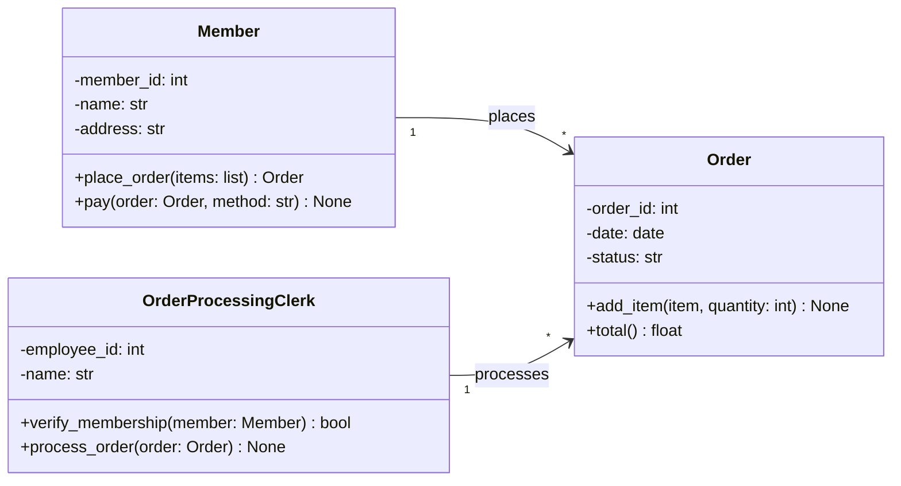
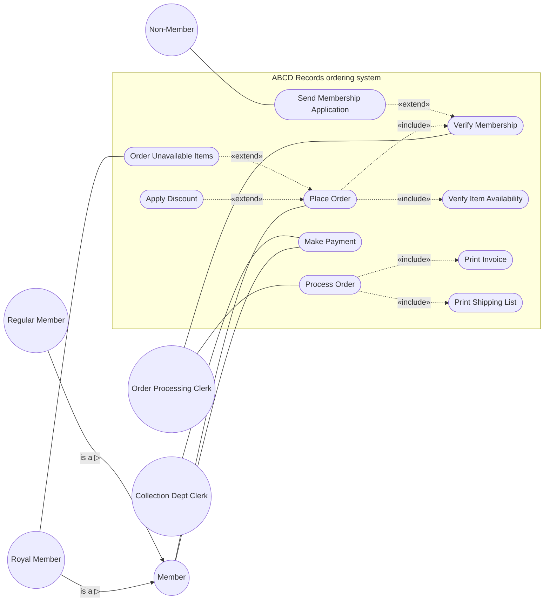
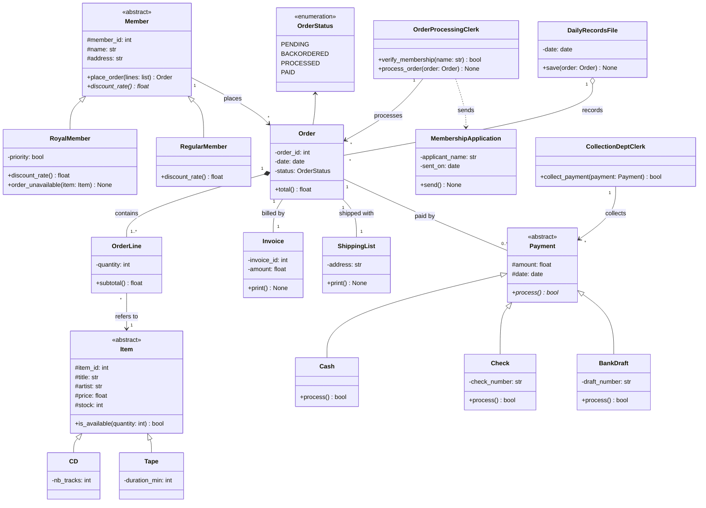
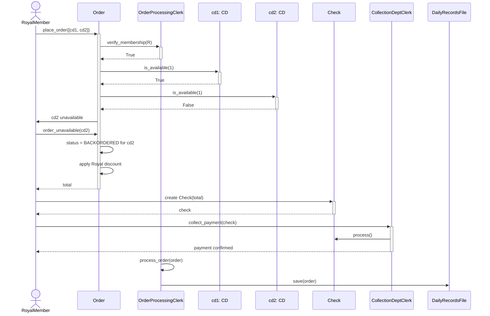
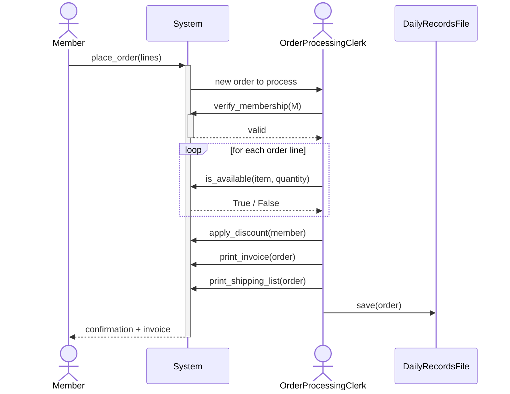
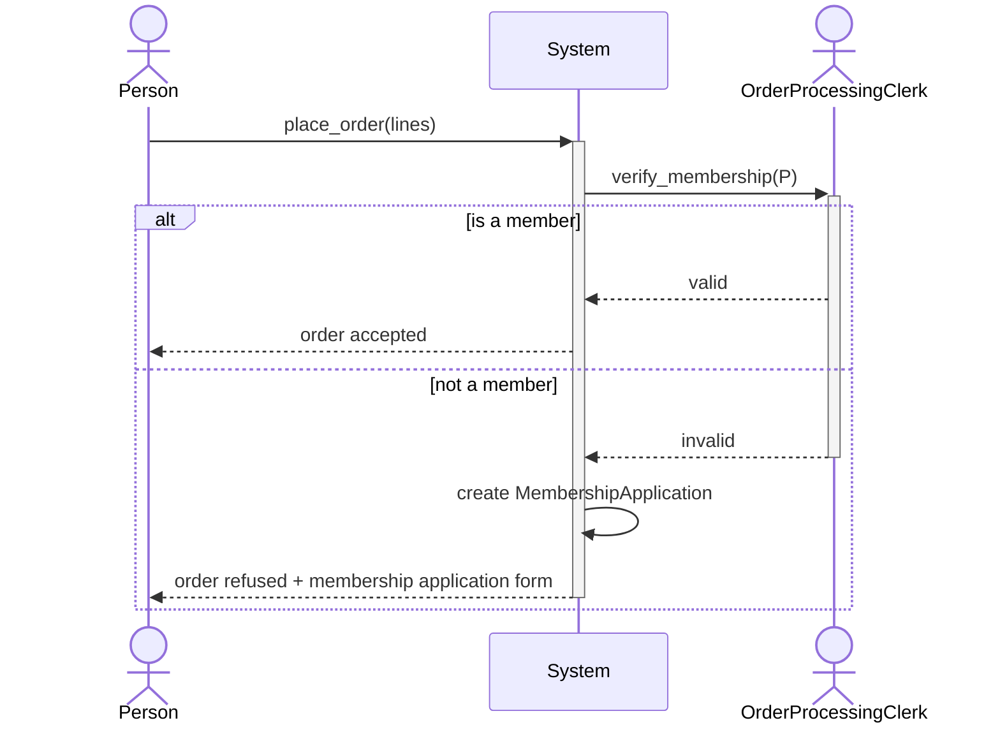
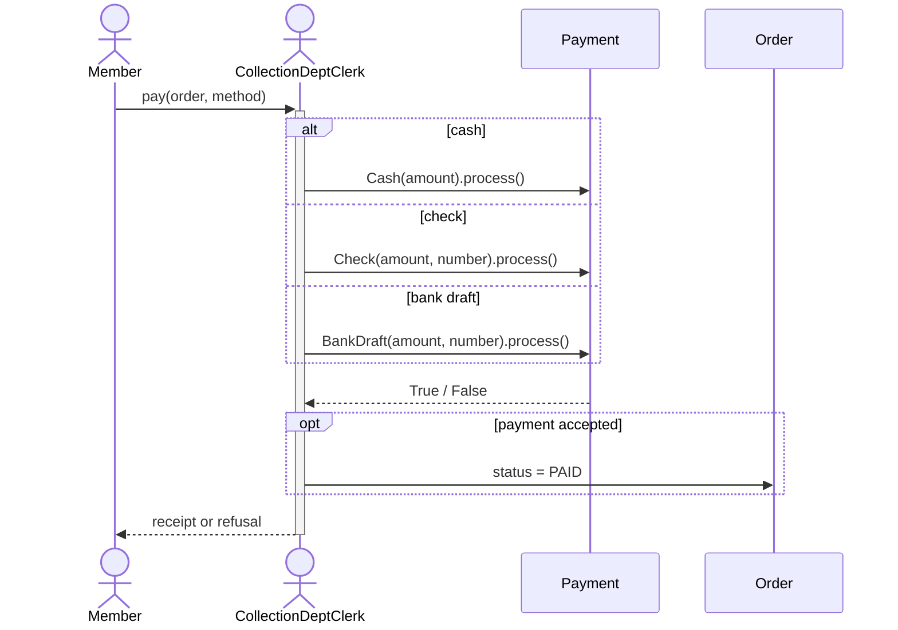
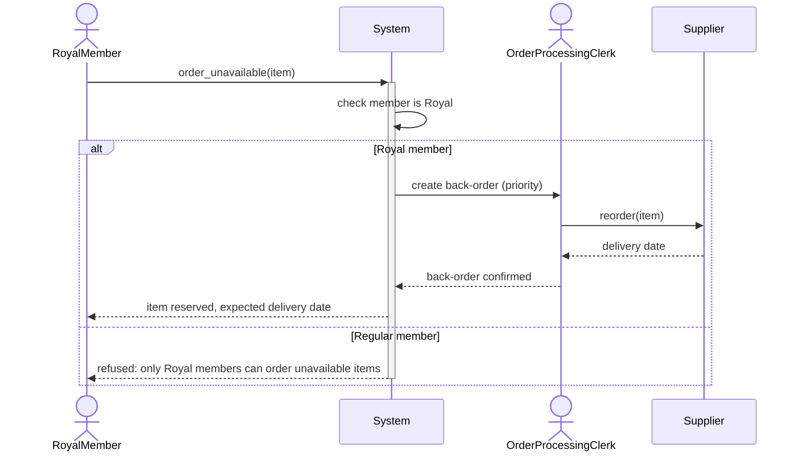

# Exo 2: ABCD Records

ABCD Records is a mail-order company selling CDs and tapes at discount prices to record club members.

- Only members can place orders; non-members receive a membership application form.
- Two member classes: **Royal** (discounts + priority) and **Regular**.
- Royal members can order unavailable items.
- Payment methods: cash, check, bank draft.
- The Order Processing Clerk handles verification and processing; the Collection Department Clerk handles payments.
- All orders are saved to a daily records file.

> GitHub's Mermaid has no native use case diagram, so use cases are drawn as a flowchart: rounded boxes = use cases, circles = actors, the frame = the system boundary, dashed arrows = «include» / «extend». On paper, use stick figures and ellipses.

---

## Level 1

### Task 1.1: simple use case diagram

`Place Order` **includes** `Verify Membership`: "only members can place orders", so the check happens every time. The arrow goes **from the base to the included** use case.

### Task 1.2: basic class diagram

---

## Level 2

### Task 2.1: complete use case diagram

| Relationship | Why |
| --- | --- |
| Place Order «include» Verify Membership | every order needs a membership check |
| Place Order «include» Verify Item Availability | every order needs a stock check |
| Process Order «include» Print Invoice / Print Shipping List | always done when processing |
| Apply Discount «extend» Place Order | optional: only Royal members get discounts |
| Order Unavailable Items «extend» Place Order | optional: only Royal members, only when an item is out of stock |
| Send Membership Application «extend» Verify Membership | only happens when the check fails (non-member) |
| Royal / Regular ▷ Member | generalization: both are members and do everything a member does |

### Task 2.2: complete class diagram

**Choices**
- `Order ◆— OrderLine`: **composition**, an order line has no meaning without its order.
- `DailyRecordsFile ◇— Order`: **aggregation**, the file lists orders but does not own them.
- `OrderLine → Item`: a plain association, the item exists in the catalogue independently.
- Inheritance for members, items and payments, as the exercise asks.

### Scenario: a Royal member orders 2 CDs (one unavailable) and pays by check

---

## Level 3: advanced sequence diagrams

### 1. Complete order processing flow

### 2. Membership verification (success and failure)

### 3. Payment processing (all types)

### 4. Item reordering for Royal members

