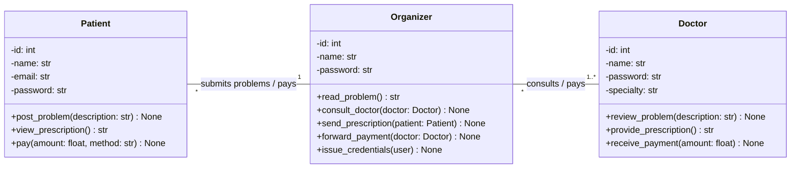
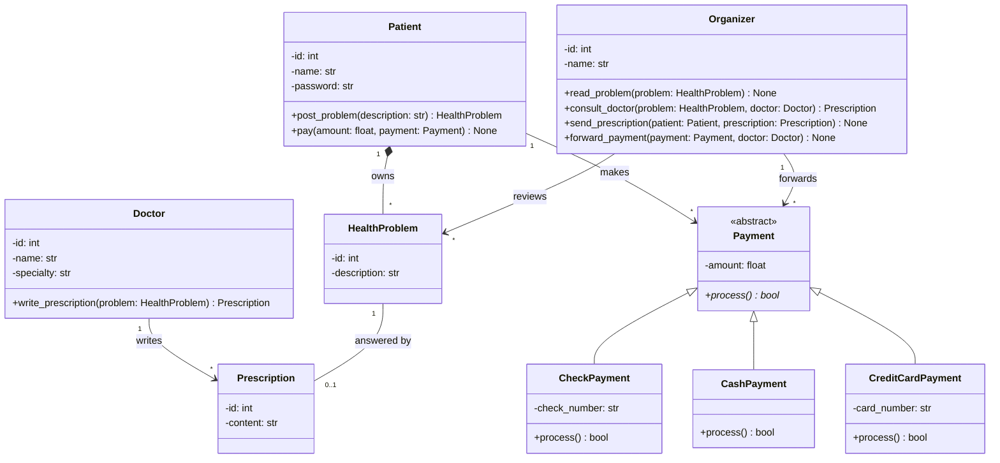
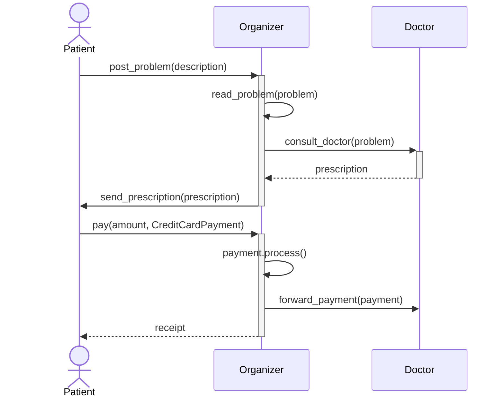
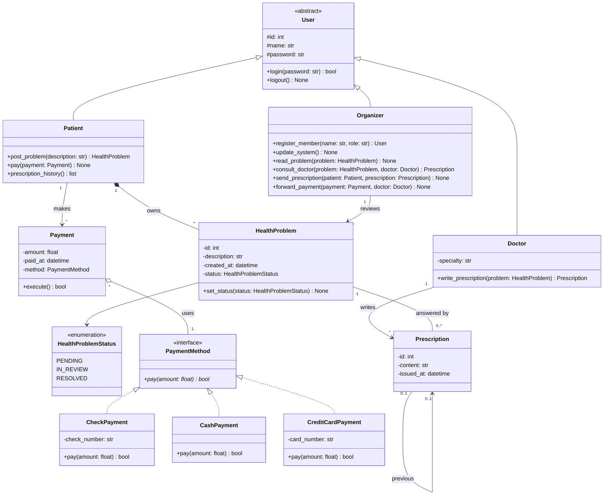
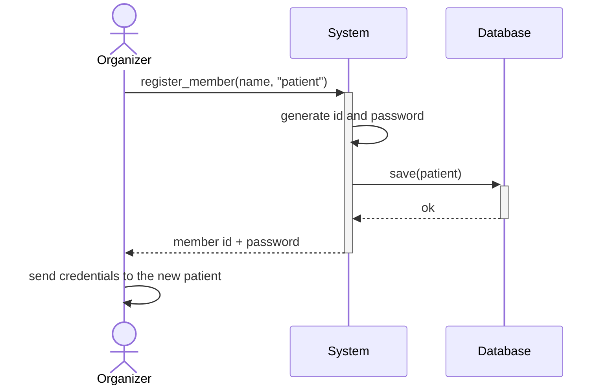
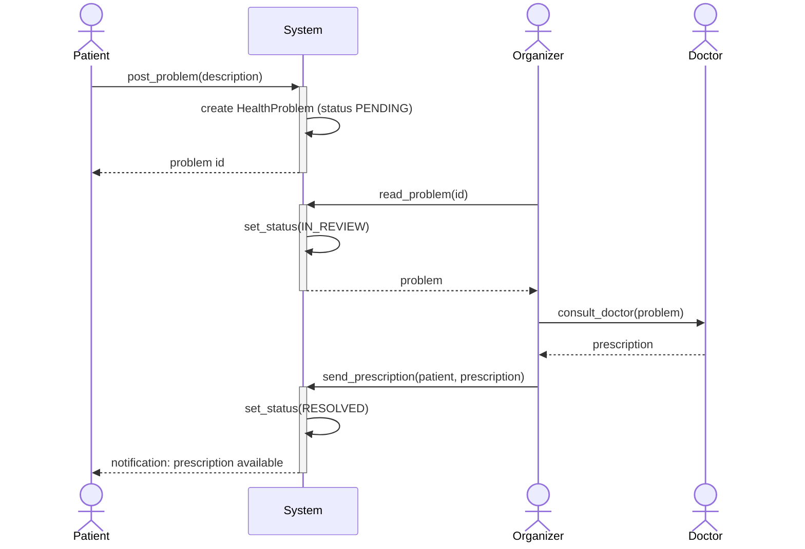
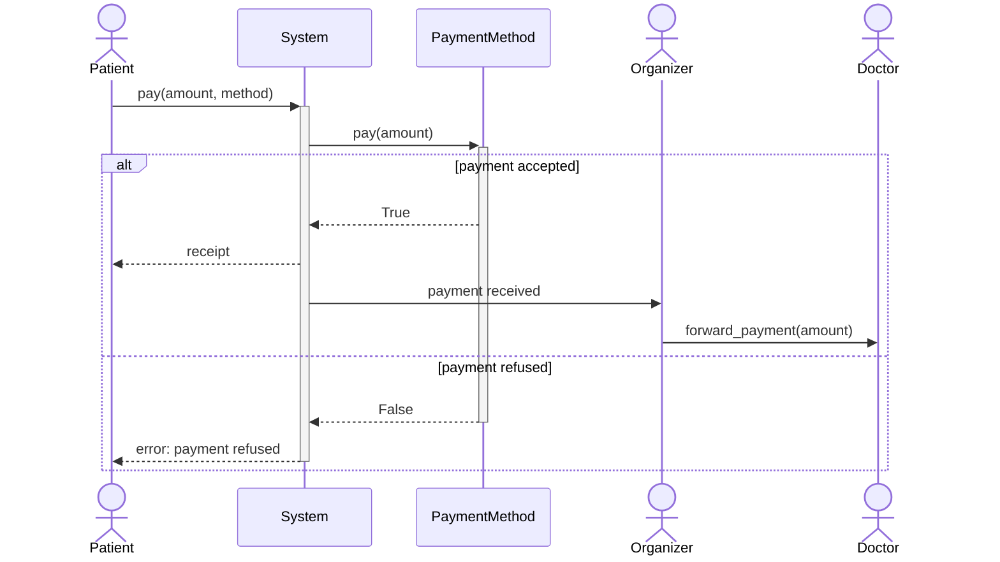

# Exo 1: Hospital Management System

**Business workflow**
1. The patient posts a health problem online.
2. The organizer reads it and consults a doctor.
3. The doctor provides a prescription.
4. The organizer sends the prescription to the patient.
5. The patient pays by check, cash or credit card.
6. The organizer forwards the payment to the doctor.

The organizer is also the administrator: maintains the database, updates the system, issues member IDs and passwords.

---

## Task 1: basic class diagram

The key point: **the patient never talks to the doctor directly**. Everything goes through the organizer, so there are only two associations.

Methods come from the **verbs** of the workflow, placed on the class that **does** the action.

---

## Task 2: complete class diagram (6 classes)

**Choices**
- `Patient ◆— HealthProblem` is **composition**: a problem only exists for the patient who posted it.
- Payment types use **inheritance** rather than an enumeration, because each type processes the payment differently (checking a card number vs a check number). An enumeration would fit if only the label changed.

### Sequence diagram: one patient submits a problem, receives a prescription, and pays

---

## Task 3: advanced design

- **`User` superclass**: `Patient`, `Doctor` and `Organizer` repeated `id`, `name`, `password`, so they move into an abstract `User` with `login()` / `logout()`.
- **Payment strategy with polymorphism**: `Payment` delegates to a `PaymentMethod` interface; the organizer calls `method.pay(amount)` without knowing the concrete type (the **Strategy** pattern).
- **Status tracking**: `HealthProblemStatus` enumeration (pending, in review, resolved).
- **Timestamps and history**: `created_at` / `issued_at`, and a prescription can reference the previous one.

### System sequence diagram 1: patient registration

### System sequence diagram 2: consultation flow

### System sequence diagram 3: payment processing

---

## Questions to consider

**How would you handle a patient consulting multiple doctors?**
`HealthProblem` → `Prescription` is `1 — 0..*`, and each prescription is linked to the doctor who wrote it. One problem can therefore get opinions from several doctors, and the patient's history gathers all of them. A `Consultation` class (problem + doctor + date) would make it explicit if more data were needed per consultation.

**Should prescriptions be reusable?**
Not as the same object: each prescription is a medical record tied to one patient, one doctor and one date. "Reuse" means **renewal**: a new `Prescription` that references the previous one (the `previous` self-association), so the history stays intact.

**Which design pattern fits the payment system?**
**Strategy**: every payment method implements the same `pay(amount)` interface, and `Payment` delegates to whichever one it holds. Adding Apple Pay means adding one class, without touching existing code (Open/Closed principle). A **Factory** can create the right `PaymentMethod` from the patient's choice.

**How do you ensure data integrity when payments are processed?**
Make the payment **atomic**: save it and update its status in a single database transaction, so a crash never leaves a half-recorded payment. Only forward money to the doctor once the payment is confirmed (`alt` block above), give each payment a unique id so it can't be processed twice, and keep an audit log with timestamps.
