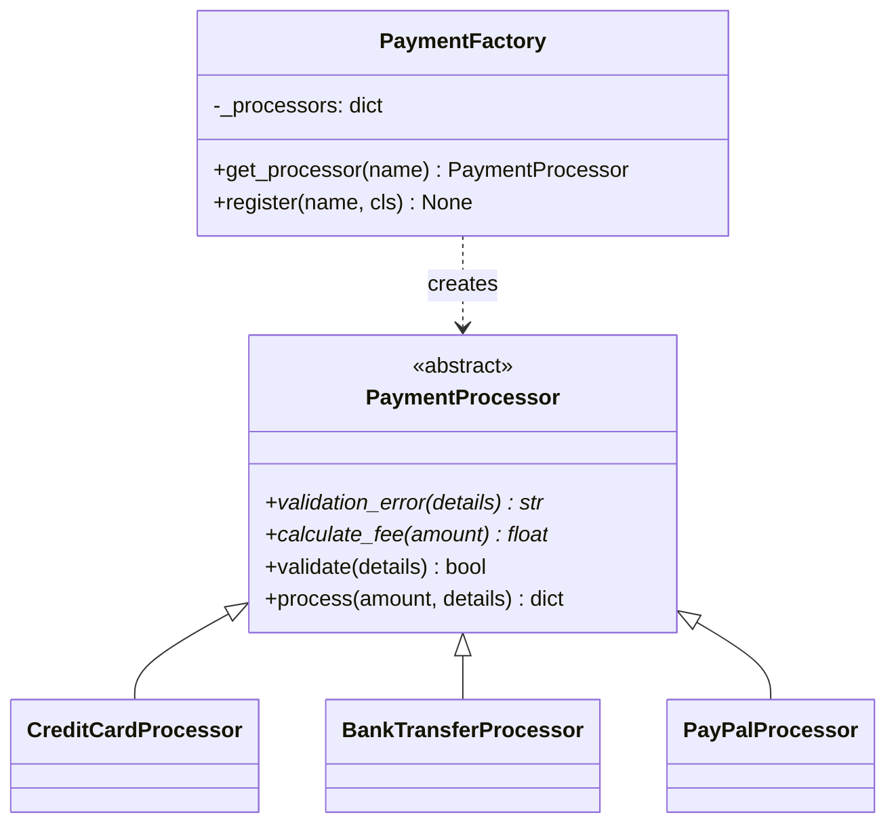
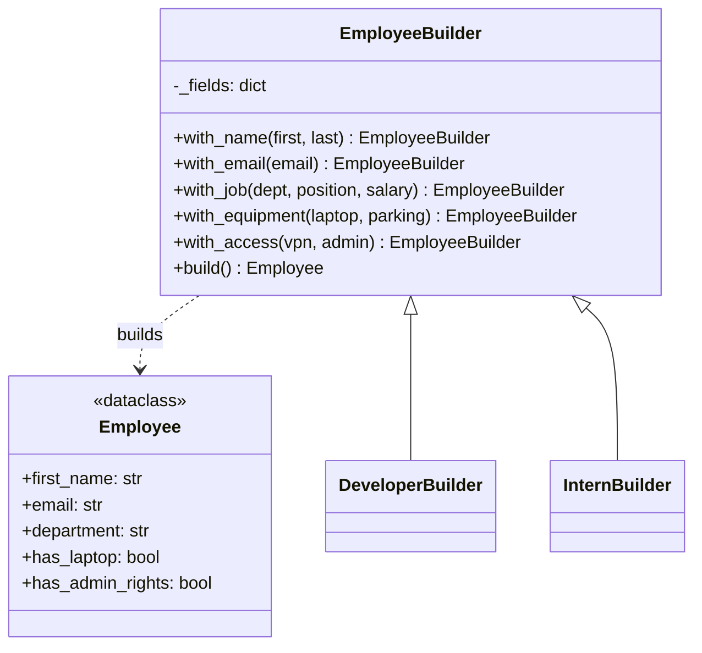
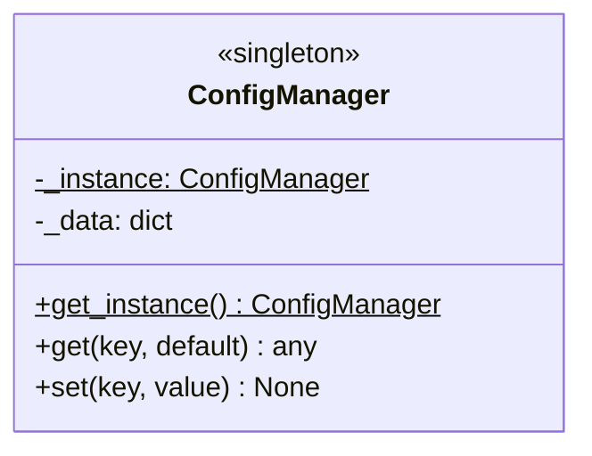
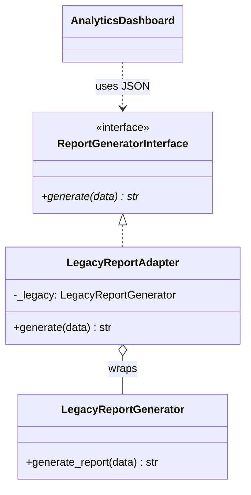
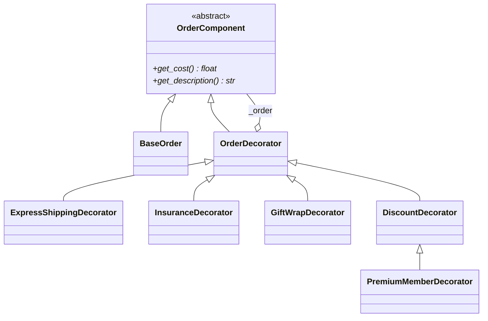
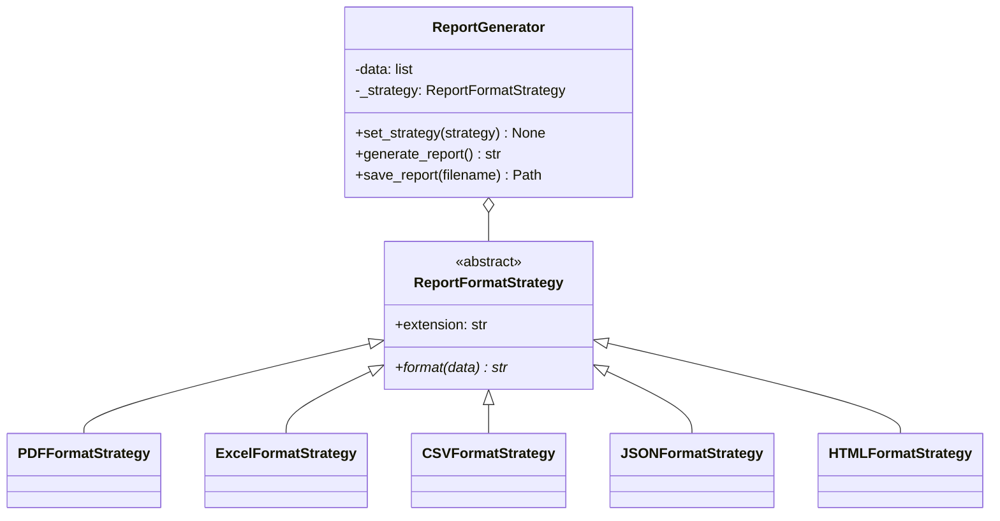
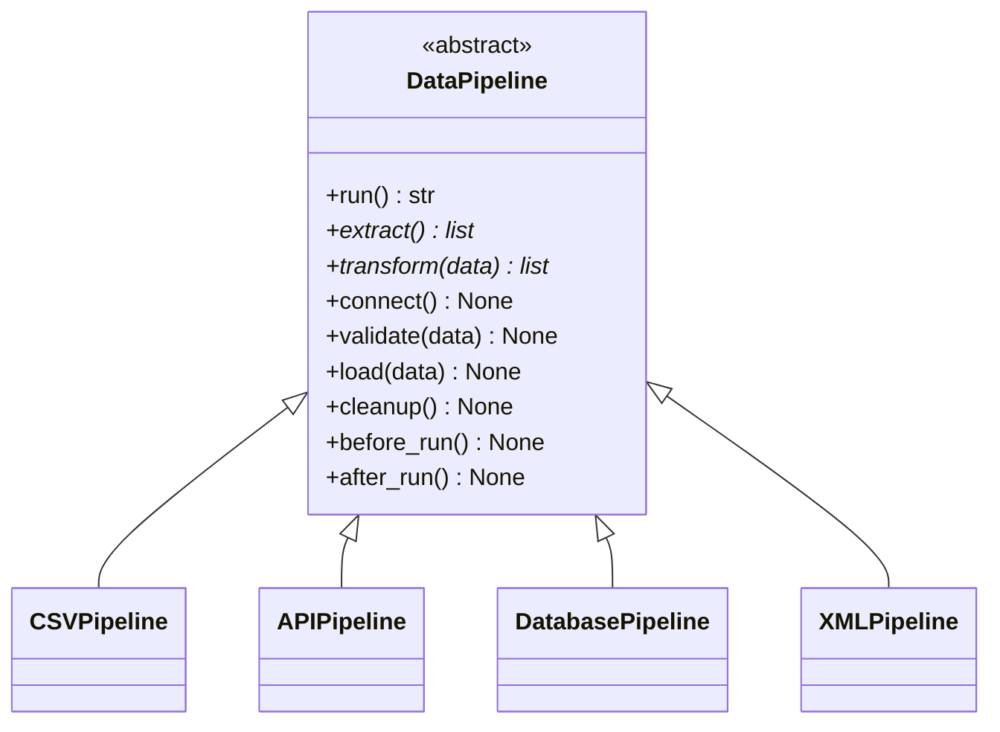

# Exercise 5 (slide 84): design patterns in practice

**Statements:** [creational](https://courses.dallard.tech/sys_design/creational_pattern/) · [structural](https://courses.dallard.tech/sys_design/structural_pattern/) · [behavioral](https://courses.dallard.tech/sys_design/behavioral_pattern/)

Seven refactoring exercises: each starts from "spaghetti" code and turns it into a pattern. Every file runs on its own (`python3 creational/factory_payment.py`), and **56 tests** check them all:

```bash
cd 05-design-patterns
pip install pytest pytest-mock
pytest
```

| Family | Pattern | Exercise | File |
| --- | --- | --- | --- |
| Creational | Factory Method | Payment system | [`creational/factory_payment.py`](creational/factory_payment.py) |
| Creational | Builder | HR employee onboarding | [`creational/builder_employee.py`](creational/builder_employee.py) |
| Creational | Singleton | Configuration manager | [`creational/singleton_config.py`](creational/singleton_config.py) |
| Structural | Adapter | XML reports into a JSON dashboard | [`structural/adapter_report.py`](structural/adapter_report.py) |
| Structural | Decorator | Order pricing options | [`structural/decorator_order.py`](structural/decorator_order.py) |
| Behavioral | Strategy | Report formats | [`behavioral/strategy_report.py`](behavioral/strategy_report.py) |
| Behavioral | Template Method | ETL data pipelines | [`behavioral/template_etl.py`](behavioral/template_etl.py) |

- **Creational** = *how objects are created*
- **Structural** = *how objects are assembled*
- **Behavioral** = *how objects share the work*

---

## 1. Factory Method: payment system

**Smell:** one `process_payment()` with an `if/elif` per payment type. Adding Apple Pay means editing a function that already works (breaks **Open/Closed**).

**Refactor:** an abstract `PaymentProcessor`, one subclass per payment type, and a `PaymentFactory` that maps a name to a class with a **dictionary**. A new method is added with `register()`, without touching existing code.



## 2. Builder: HR onboarding

**Smell:** `create_employee()` takes 17 positional arguments (`False, True, True...`): one missing `None` shifts everything ("telescoping constructor").

**Refactor:** `Employee` is a `@dataclass` (the product). `EmployeeBuilder` has small methods that each **return `self`**, so calls chain and read like a sentence. All validation lives in `build()`. `DeveloperBuilder` and `InternBuilder` are presets, so a senior developer *always* gets admin rights.



## 3. Singleton: configuration manager

**Smell:** every module calls `load_config()`, so `config.json` is read 4 times per request, and each module has its own copy (a change in one isn't seen by the others).

**Refactor:** `ConfigManager.get_instance()` (a `@classmethod`) creates the instance on the first call and returns the same one afterwards. The file is read **once**, and `get("database.host")` reads nested values.



## 4. Adapter: XML reports in a JSON dashboard

**Smell:** the legacy generator returns XML (and can't be modified), the dashboard wants JSON, and every function does its own conversion. The original code even cheats by reusing the input dict instead of converting.

**Refactor:** `LegacyReportAdapter` implements `ReportGeneratorInterface`, wraps the legacy object, and **really** converts its XML into JSON (`xml.etree`). The dashboard never knows it's talking to a legacy system.



## 5. Decorator: order pricing

**Smell:** `calculate_total()` takes 5 boolean flags with one `if` per option. A new option means a new parameter and an edit to the method (breaks Single Responsibility and Open/Closed).

**Refactor:** `BaseOrder` and every option implement `OrderComponent` (`get_cost()`, `get_description()`). Each decorator wraps an order, adds its own cost, and delegates the rest. Options stack in any combination. The final total (95.625€) is **identical** to the original code, so the refactor didn't change the business rules.



## 6. Strategy: report formats

**Smell:** `generate_report()` and `save_report()` each repeat an `if/elif` per format.

**Refactor:** one strategy class per format behind `ReportFormatStrategy`. `ReportGenerator` (the context) holds the current strategy and can **switch it at runtime** with `set_strategy()`. The final test of the exercise: `HTMLFormatStrategy` was added **without modifying any existing class**.



## 7. Template Method: ETL pipelines

**Smell:** three pipeline classes copy the same connect → extract → transform → validate → load → cleanup workflow. Adding logging means editing all three.

**Refactor:** `DataPipeline.run()` is the **template method**: it fixes the order of the steps, so no pipeline can skip one. Common steps (`connect`, `validate`, `load`, `cleanup`) are written **once**. Subclasses only implement `extract()` and `transform()`. `before_run()` / `after_run()` are **hooks**: empty by default, overridden only if needed (`APIPipeline` checks a rate limit). The new `XMLPipeline` only writes its XML-specific parts.



---

## Strategy vs Template Method (classic exam trap)

| | Strategy | Template Method |
| --- | --- | --- |
| Mechanism | **composition**: the context *holds* a strategy object | **inheritance**: subclasses *override* steps |
| What changes | the **whole** algorithm | **some steps**, the order stays fixed |
| When it changes | at **runtime** (`set_strategy`) | when the class is written |
