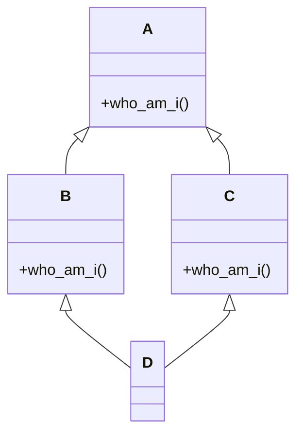

# Exercise 7 (slides 37–38): multiple inheritance and MRO

The slides show the diamond example and ask *"Which method to call?"*. This exercise answers it, then covers `super()` and mixins. **11 tests.**

```bash
python3 diamond.py
python3 super_chain.py
python3 mixins.py
pytest
```

## 1. The diamond: [`diamond.py`](diamond.py)



| Class | MRO | `who_am_i()` |
| --- | --- | --- |
| `D(B, C)` | D → B → C → A → object | **Class B** |
| `E(C, B)` | E → C → B → A → object | **Class C**: the parent order matters |
| `G(BNoMethod, C)` | G → BNoMethod → C → A → object | **Class C**, *not* A: the trap |

**The rule (C3 linearization):** the class itself first, then its parents **left to right**, and a shared parent only **after all its children**. `object` is always last. Python takes the **first** class in that list that defines the method.

Check it with `D.__mro__` (a tuple) or `D.mro()` (a list). If no order can respect the rules, Python refuses to create the class: `TypeError: Cannot create a consistent method resolution order`.

## 2. `super()` follows the MRO: [`super_chain.py`](super_chain.py)

```
Child().greet()  →  Child → Left → Right → Base
```

Inside `Left`, `super().greet()` goes to **`Right`**, not to `Base`, because `Right` is next in `Child`'s MRO. Each class runs **exactly once**, and the shared `Base` runs last. This is why the C3 order exists.

## 3. Mixins vs composition: [`mixins.py`](mixins.py)

- A **mixin** is a small class that adds **one** ability (`JsonMixin` → `to_json()`, `ReprMixin` → `__repr__`) and isn't used alone. Mixins go first and the real parent goes last: `class SmartProduct(JsonMixin, ReprMixin, Product)`.
- **Composition** gets the same result without multiple inheritance: `Catalog` **has a** `JsonExporter` instead of **being** one.

The course's advice: *"in 99.9% of cases, you don't need multiple inheritance"*. **Prefer composition over inheritance.**
