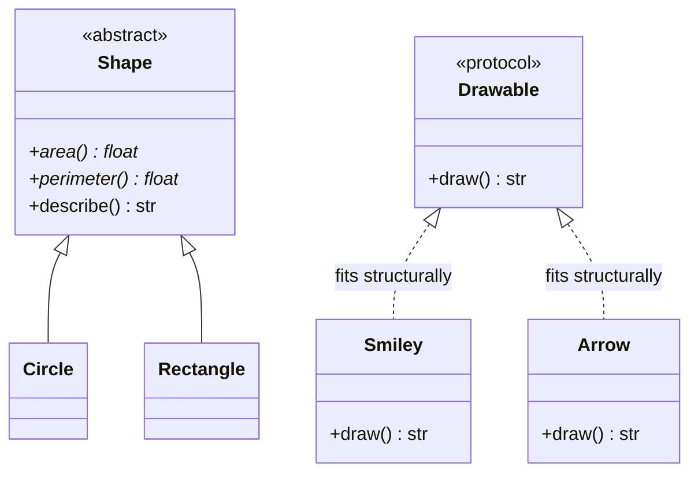

# Exercise 8 (slides 32–33, 39, 61–64): ABCs, Protocols, special methods and built-in decorators

**22 tests.**

```bash
python3 shapes_abc.py
python3 playlist.py
pytest
```

## 1. ABC vs Protocol: [`shapes_abc.py`](shapes_abc.py)

The same idea (a common contract) done both ways.



| | ABC (`Shape`) | Protocol (`Drawable`) |
| --- | --- | --- |
| Inheritance needed? | yes: `class Circle(Shape)` | **no**: `Smiley` just has a `draw()` method |
| Shared code? | yes: `describe()` is concrete | no, signatures only |
| Checked when? | **runtime**, when the object is created | by the **type checker** (mypy) before running; `@runtime_checkable` also allows `isinstance` |
| Error if incomplete | `Shape()` or `BrokenSquare(2)` → `TypeError` at creation | type checker warning |

Exam trap: the `TypeError` happens **when the object is created**, not when the missing method is called.

## 2. Special methods: [`playlist.py`](playlist.py)

`Playlist` behaves like a built-in list thanks to dunders:

| Python syntax | Dunder |
| --- | --- |
| `len(p)` | `__len__` |
| `for song in p` | `__iter__` |
| `p[0]`, `p[1:3]` | `__getitem__` |
| `song in p` | `__contains__` |
| `p1 + p2` (returns a **new** playlist) | `__add__` |
| `p1 == p2` | `__eq__` |
| `if p:` | `__bool__` |
| `print(p)` (for users) | `__str__` |
| console / debugging (for developers) | `__repr__` |

## 3. Built-in decorators on `Song`

| Decorator | On `Song` | Effect |
| --- | --- | --- |
| `@dataclass(order=True, frozen=True)` | the class | writes `__init__`, `__repr__`, `__eq__`; `order=True` adds `<` `>` `<=` `>=` (so `sorted()` works); `frozen=True` makes it read-only |
| `@property` | `minutes` | read without parentheses: `song.minutes` → `"2:07"` |
| `@classmethod` | `from_string(cls, text)` | **factory method**, receives the class: `Song.from_string("Intro - The xx - 2:07")` |
| `@staticmethod` | `parse_duration(mmss)` | helper with **no `self`, no `cls`** |
