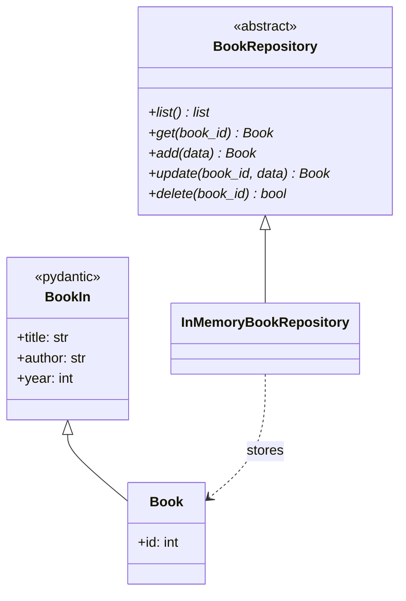

# Exercise 9 (slides 39–40): decorators in practice with FastAPI

A small **Library API**: create, read, update and delete books. **12 tests.**

```bash
pip install -r requirements.txt
uvicorn main:app --reload      # then open http://127.0.0.1:8000/docs
pytest
```

## Route decorators

Each `@app.<method>(path)` decorator **registers** the function below it as an endpoint. There's no manual routing table: the decorator does it when the module is loaded (`test_decorators_registered_the_routes` checks this).

| Decorator | Endpoint | Returns |
| --- | --- | --- |
| `@app.get("/books")` | list all books | 200 |
| `@app.get("/books/{book_id}")` | one book | 200 or 404 |
| `@app.post("/books")` | create a book | 201, needs the API key |
| `@app.put("/books/{book_id}")` | replace a book | 200 or 404, needs the API key |
| `@app.delete("/books/{book_id}")` | delete a book | 204 or 404, needs the API key |

## Dependency injection with `Depends()`

```python
@app.get("/books")
def list_books(repo: BookRepository = Depends(get_repository)):
    return repo.list()
```

- `Depends(get_repository)` **injects** the data layer: the route doesn't create or know the repository. It only calls its methods.
- `Depends(require_api_key)` adds an authentication check to every write route, written **once**.
- In tests, `app.dependency_overrides` swaps the real repository for a fresh one, or for a **mock**. That's the same mocking idea as exercise 6.

## Design



- **`BookRepository` is an ABC**: a database version would implement the same contract, and the routes wouldn't change (Dependency Inversion, the D in SOLID).
- **Pydantic models** validate request bodies automatically: a negative `year` returns **422**, without a single `if` in the route.
- **`_repository`** is created once at module level: the "module-level instance" the slides suggest instead of a Singleton class.
